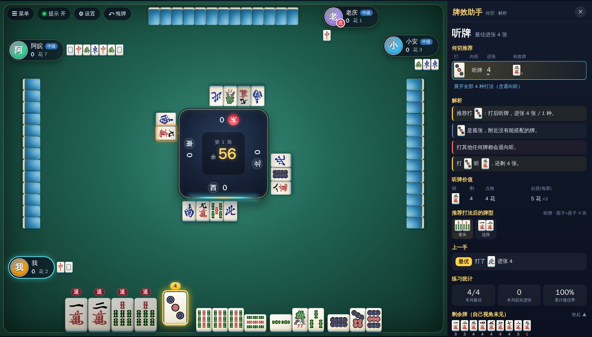
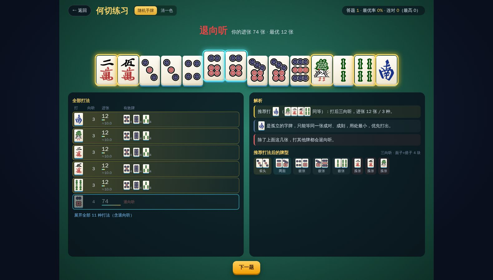
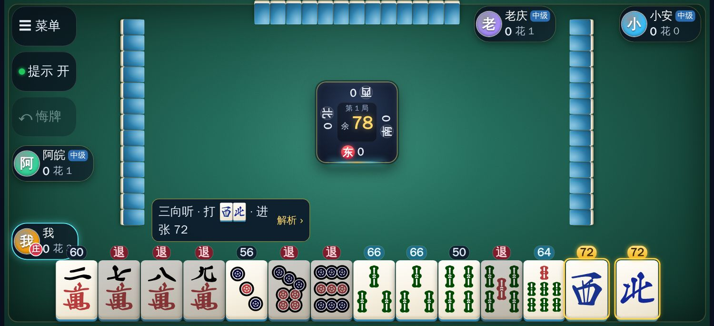
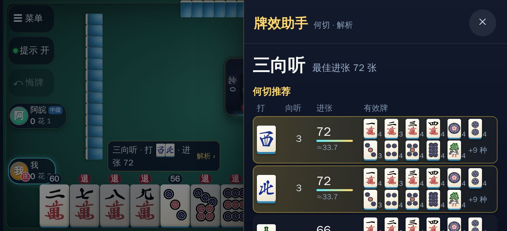

# 安庆麻将 · 牌效练习场

单人练习用的安庆麻将网页版：四人房，其余三家是可调难度的电脑；带可开关的**何切提示与解析**，局后复盘牌效，帮助提高牌效率。纯前端，可直接部署成静态网站。

**在线试玩：[besire.github.io/anqing-mahjong](https://besire.github.io/anqing-mahjong/)**

| 对局 + 提示面板 | 结算 |
| --- | --- |
|  |  |
| **首页** | **何切练习** |
|  |  |

## 规则（默认）

- 万条筒 1–9 + 南西北，共 120 张可打牌；**白、中、发、东**共 16 张是花牌，摸到即亮出并从牌尾补牌，每张 +1 花。
- 牌型能胡就行（4 面子 + 1 将），无番种要求；可吃（只吃上家）、碰、杠。
- 算花：底花 1；花牌各 +1；自摸 +1；每个杠 +1（明暗一样）；南西北刻子各 +1；杠上开花 +1（补花后摸到胡牌也算）。
- 结算：点炮由放炮者一人付总花数；自摸三家各付总花数。
- 房规可调：七对、清一色/碰碰胡加花、一炮多响、抢杠胡、庄家规则、局数。

## 功能

- **四人房人机对战**：下家/对家/上家可分别设成 新手 / 中级 / 高手，出牌速度可调。
- **何切提示（快捷键 H 开关）**
  - 每张手牌上显示打出后的进张数，最优打法金色高亮，退向听的标"退"。
  - 何切推荐表：每种打法的向听、进张张数、有效牌及剩余枚数；进张相同时用两步前瞻（≈ 后的数字，下一步的平均进张）比较好型。
  - 解析：为什么打这张（孤张/搭子过剩/拆哪种搭子……）、次选差多少、哪些牌会退向听、听牌后每张胡牌值多少花、南西北对子的价值提示、杠的建议。
  - 牌型拆解：面子 / 雀头 / 两面 / 嵌张 / 边张 / 对子 / 孤张。
  - 吃碰杠胡时给出叫与不叫的向听、进张对比和建议。
  - 剩余牌表（自己视角未见的牌）。
- **复盘**：每一手都会评分（最优 / 次优 / 损失进张 / 退向听），提示关闭时也记录，局后列出失误；首页累计最优率。
- **悔牌**（Z）撤销自己上一步，**重打本局**用同一副牌再来。
- **何切练习**：随机手牌或清一色出题，选完立即给出完整分析。
- 雀魂风格界面：3D 牌面、吃碰杠胡大字特效、出牌音效（WebAudio 合成）、桌面自适应缩放，手机横屏也能玩。

快捷键：`H` 提示开关，`空格` 过，`回车` 胡/自摸，`Z` 悔牌，`Esc` 菜单。

## 手机玩法

| 横屏牌桌 | 完整解析抽屉 |
| --- | --- |
|  |  |

- 对局使用**专用横屏牌桌**：手牌更大，提示开关不挤压手牌区域。竖屏进入对局时提示旋转手机；首页和何切练习支持竖屏。
- **点一下选牌，再点同一张出牌**，或**向上滑动直接出牌**。开启提示时，点选的牌会在提示条中显示牌效预览。
- 简要提示条显示推荐打哪张、向听与进张，点击「解析」展开详细抽屉。抽屉文字保持正常字号，内容可滚动。
- 自己起手补花和之后摸到花会明确提示具体花牌与加花数；点击头像旁的「花 X」查看花牌明细（不依赖何切提示开关）。
- 设置和结算弹窗不随牌桌缩小，长内容可滚动。
- Android 浏览器可从菜单进入全屏；支持时尝试锁定横屏。iPhone Safari 推荐「分享 → 添加到主屏幕」，从图标启动可减少浏览器工具栏占用。
- 附带 Web App Manifest 和主屏幕图标。当前需要联网加载，尚未提供离线缓存。全屏、方向锁定和音效仍取决于浏览器支持。

浏览器验证覆盖 Chromium 的 iPhone/Pixel 模拟、WebKit 的 iPhone 模拟，以及桌面回归；尚未在实体手机上验证。

## 开发

```bash
npm install
npm run dev        # 本地开发 http://localhost:5173
npm test           # 单元测试（向听与朴素算法交叉验证、算花、整局模拟）
npm run sim        # AI 难度对战模拟（较慢）
npm run build      # 产物在 dist/
npx playwright install --with-deps chromium webkit
npm run test:e2e   # 手机横竖屏、触控、抽屉、整局结算与桌面回归
```

## 部署

`npm run build` 后 `dist/` 是纯静态文件（`base: './'`，可以放在任意路径下）。

- **GitHub Pages**：推到 GitHub，仓库 Settings → Pages → Source 选 *GitHub Actions*，已附带 `.github/workflows/deploy.yml`，推送 `main` 分支自动构建发布。
- **Vercel / Netlify / Cloudflare Pages**：导入仓库，构建命令 `npm run build`，输出目录 `dist`。
- **自己的服务器**：把 `dist/` 丢到 nginx 等任意静态服务器；或 `docker build -t anqing-mj . && docker run -p 8080:80 anqing-mj`。

## 技术栈与结构

Vite + React 19 + TypeScript + Zustand，Vitest 和 Playwright 测试，无后端。

```
src/core/          纯逻辑（与界面无关，可单测）
  tiles.ts         牌的编码：0-26 万筒条，27-29 南西北，30-33 东白发中（花）
  shanten.ts       向听/进张：按花色求面子搭子帕累托前沿并缓存，微秒级
  win.ts           胡牌拆解与算花
  game.ts          对局引擎（发牌、补花、吃碰杠胡、抢杠、流局、结算、庄家）
  analysis.ts      何切分析、两步前瞻、吃碰建议、牌型拆解
  hint.ts          把分析组织成提示与解析文字、打牌评分
  ai.ts            电脑对手（三档难度）
src/store/         Zustand：驱动机器人行动、提示、统计、悔牌
src/ui/            React 组件、桌面/手机布局、提示抽屉、触控和样式
e2e/               Playwright 浏览器与触控回归
scripts/duel.sim.ts  AI 对战模拟
tools/python/      早期的命令行算花脚本（独立，可选）
```

### 关于 AI 难度

- 新手：只看向听、经常随手打，吃碰随缘。
- 中级：标准牌效（向听 + 进张），能减少向听就吃碰，偶尔选次优。
- 高手：两步前瞻 + 不随手 + 进张相同时打更安全的牌。

用 `npm run sim` 做过对战模拟：这套规则节奏很快、自摸三家付，弃和、留字牌等策略反而亏分，所以高手主要靠速度和效率取胜（约比中级每局多 +0.14 花，新手约 -1.4 花）。

## 素材

牌面 SVG 来自 [FluffyStuff/riichi-mahjong-tiles](https://github.com/FluffyStuff/riichi-mahjong-tiles)（公有领域 CC0），白板为自绘。
